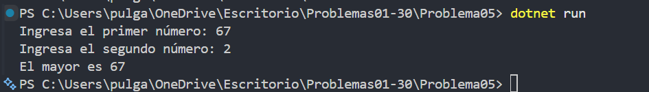

# Problema 05. El mayor de dos números

**Estructura elegida:** operador ternario

**Justificación:** Se usa el operador ternario para elegir en una sola asignación cuál de los dos números es mayor.

**Evidencia:**

