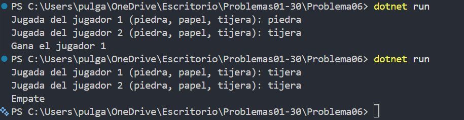

# Problema 06. Piedra, papel o tijera

**Estructura elegida:** if / else if / else

**Justificación:** Se usan condiciones combinadas para detectar empate, victoria de cada jugador y entradas no válidas.

**Evidencia:**

