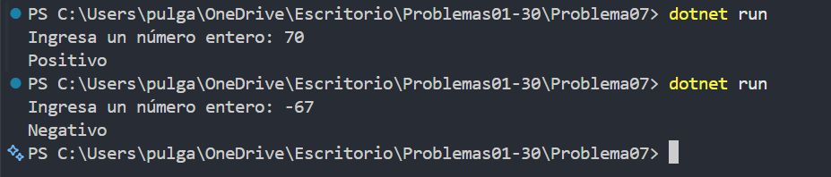

# Problema 07. Signo de un número

**Estructura elegida:** if / else if / else

**Justificación:** Se comparan tres posibilidades mutuamente excluyentes: positivo, negativo o cero.

**Evidencia:**

