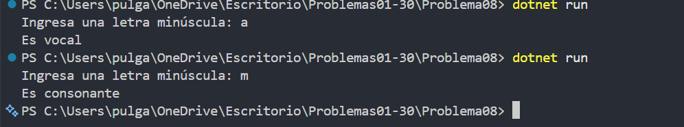

# Problema 08. Vocal o consonante

**Estructura elegida:** if / else if / else

**Justificación:** Se valida primero que la entrada sea una letra y luego se distingue entre vocal y consonante.

**Evidencia:**

