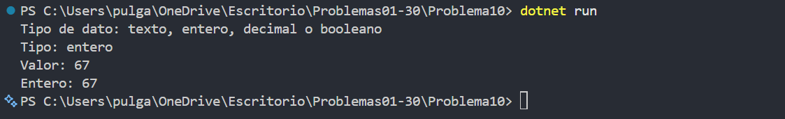

# Problema 10. Analizador de datos recibidos

**Estructura elegida:** switch con patrones

**Justificación:** Se usa `switch` con patrones de tipo para describir el valor guardado como `object`.

**Evidencia:**

