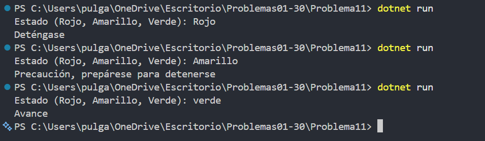

# Problema 11. Semáforo inteligente

**Estructura elegida:** enum y switch

**Justificación:** Un `enum` limita los estados posibles y `switch` asigna una instrucción a cada estado.

**Evidencia:**

