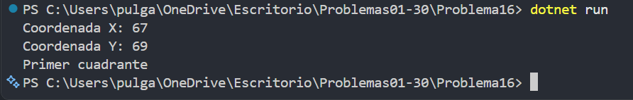

# Problema 16. Ubicación de un dron

**Estructura elegida:** if / else if con operadores lógicos

**Justificación:** Se combinan los signos de X y Y para identificar origen, ejes y cuadrantes.

**Evidencia:**

