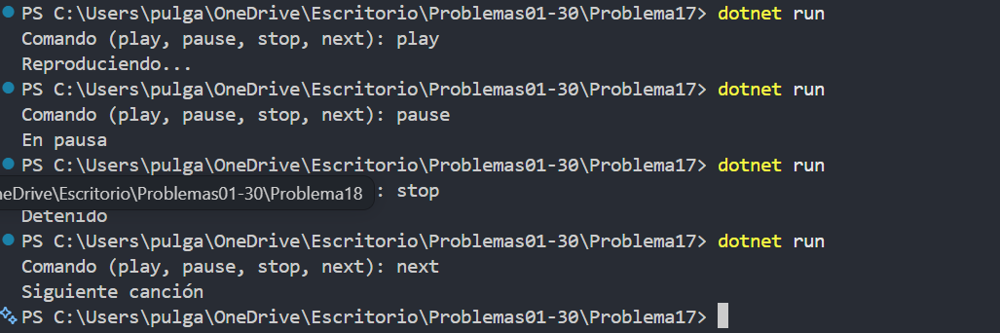

# Problema 17. Control de un reproductor

**Estructura elegida:** switch expression

**Justificación:** Cada comando de texto coincide con una opción exacta y produce un mensaje distinto.

**Evidencia:**

