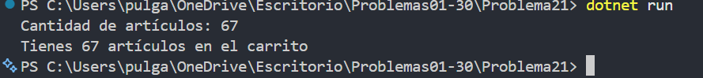

# Problema 21. Carrito de compras

**Estructura elegida:** operador ternario

**Justificación:** Se escoge singular únicamente cuando la cantidad es exactamente uno; en los demás casos va plural.

**Evidencia:**

