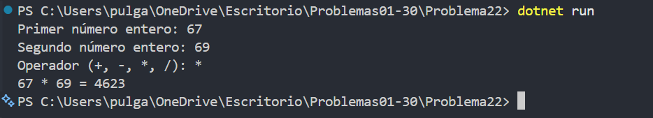

# Problema 22. Calculadora básica

**Estructura elegida:** switch y excepciones

**Justificación:** `switch` resuelve cada operador y las excepciones representan división entre cero y operador no soportado.

**Evidencia:**

