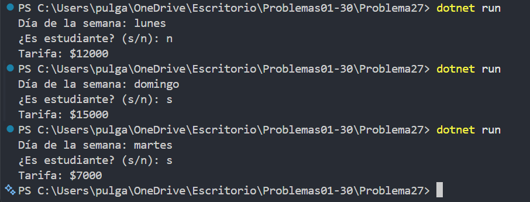

# Problema 27. Taquilla de cine

**Estructura elegida:** if / else if con condiciones combinadas

**Justificación:** El precio depende de reglas del día y, para ciertos días, también de si es estudiante.

**Evidencia:**

