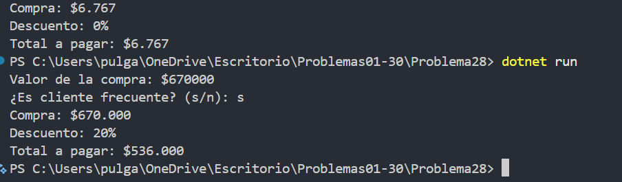

# Problema 28. Descuento por compra

**Estructura elegida:** if / else if y condición combinada

**Justificación:** Se determina el descuento base por rangos y se suma el beneficio frecuente cuando aplica.

**Evidencia:**

