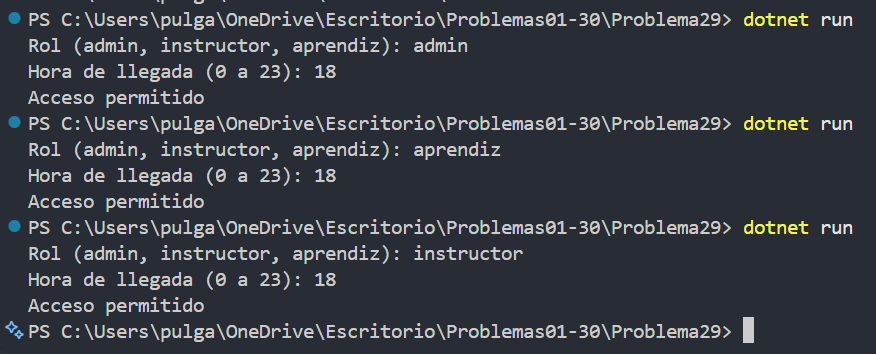

# Problema 29. Control de acceso a la sede

**Estructura elegida:** switch expression y condiciones

**Justificación:** Cada rol tiene una regla de horario propia y los demás casos deniegan el acceso.

**Evidencia:**

