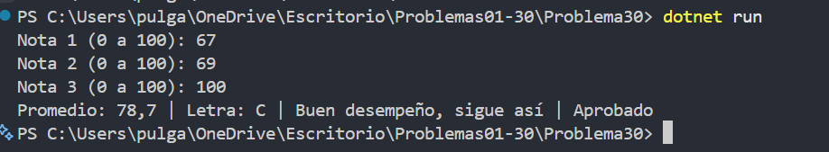

# Problema 30. Boletín de calificaciones

**Estructura elegida:** if / else if, switch y ternario

**Justificación:** Se combinan rangos para la letra, alternativas para la retroalimentación y una condición para aprobar y mencionar honor.

**Evidencia:**

